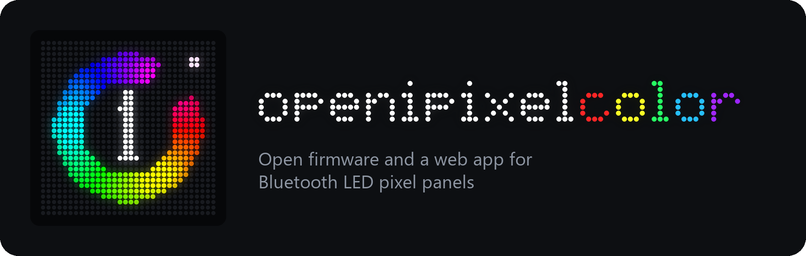
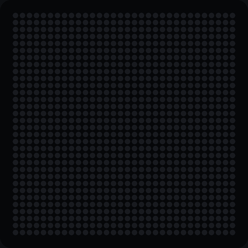
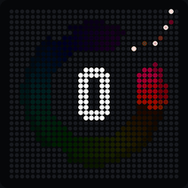
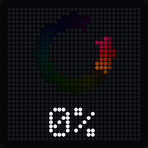

<p align="center"></p>

<p align="center">
  <a href="https://github.com/Almo7aya/openipixelcolor/actions/workflows/firmware.yml"></a>
  <a href="https://github.com/Almo7aya/openipixelcolor/releases/latest"></a>
  <a href="LICENSE"></a>
  <a href="https://almo7aya.dev/openipixelcolor/"></a>
  <a href="#supported-devices"></a>
</p>

<p align="center"><b>Open-source firmware and a browser app for iPixel Color LED pixel panels.</b><br>
Install it over Bluetooth, from your browser: no programmer, no soldering, nothing to install on the computer.</p>

<p align="center">
  <a href="https://almo7aya.dev/openipixelcolor/"><b>Open the web app</b></a> &nbsp;|&nbsp;
  <a href="#quick-start">Quick start</a> &nbsp;|&nbsp;
  <a href="https://github.com/Almo7aya/openipixelcolor/releases">Releases</a> &nbsp;|&nbsp;
  <a href="docs/PROTOCOL.md">Protocol</a> &nbsp;|&nbsp;
  <a href="CONTRIBUTING.md">Contributing</a>
</p>

---

openipixelcolor is made specifically for **iPixel Color devices**: the Bluetooth RGB LED pixel panels that
are sold under many brands, advertise as `LED_BLE_…` and are normally controlled with the iPixel Color phone
app. It replaces the panel's firmware with one written from scratch in C, and comes with a web app that
controls the panel straight from Chrome or Edge over Web Bluetooth.

> [!WARNING]
> Installing firmware on these panels can leave one that will not take another update: Bluetooth is the only
> way in on a closed panel. Read [Safety](#safety) before installing anything. This software comes with
> **no warranty** (see [LICENSE](LICENSE)).

<p align="center">
  
  
  
  
</p>

## Contents

- [Features](#features)
- [Supported devices](#supported-devices)
- [Quick start](#quick-start)
- [The web app](#the-web-app)
- [Command-line tools](#command-line-tools)
- [Building from source](#building-from-source)
- [Safety](#safety)
- [Project layout](#project-layout)
- [Contributing](#contributing)
- [License](#license)

## Features

- **65 effects:** plasma, fire, matrix rain, starfield, game of life, fireworks, ripples, sparkles, rainbow
  swirl, tunnel, snake, pong, bouncing balls, equalizer, aurora, lava lamp, rainstorm, DNA helix, warp
  speed, radar; demoscene classics (rotozoom, twister, copper bars, shadebobs, kaleidoscope, Julia fractal,
  moiré, sunburst, spirograph, 3D cube, synthwave, terrain flyover, plasma globe, tartan); little worlds
  and simulations (ocean, falling sand, Langton's ants, a flock of boids, galaxy, snowfall, aquarium,
  fireflies, a maze that builds and solves itself, sorting algorithms, pendulum wave, brick breaker,
  meadow); eight fan-made THE FINALS logo animations (intro, live, cash-out, spin, chrome, CRT, neon,
  shatter); and synthwave (neon mountains, neon drive, palm beach, neon city, laser tunnel, vector
  mountains, vaporwave, VHS, laser show, cassette). Shuffle through them at an interval you choose.
- **43 clock faces:** digital, analog, binary, big digits, plasma, flip, nixie, rings, day and night sky,
  pong, words, Berlin clock, Fibonacci, morphing digits, hourglass, falling bricks, matrix, fire, LCD
  watch, neon sign, dice, moon phase, orbit, progress (day, week, month, year), colour code, Roman
  numerals; digits built from falling blocks, count the squares (TIX style), abacus, oscilloscope, a
  clock of 24 clocks whose hands draw the digits, station clock (the second hand waits at the top),
  cuckoo clock, VFD, flip-dot, terminal, odometer, an hour candle, decimal time, radar, ticker, a
  melting clock and 3D digits. 12 or 24 hours, date optional.
- **Text:** a playlist of up to 4 messages with 23 ways in and out, 11 effects while shown, 9 colour modes,
  shadow, outline and glow, animated backgrounds and live `{time}` `{date}` values. Any language: the web app
  draws the text with your computer's fonts, Arabic and right-to-left included.
- **Your own animations, stored on the panel:** from a GIF, an animated WebP or PNG, a video or a few
  pictures, drawn frame by frame, or generated: 3D scenes, optical illusions, your own picture or GIF in 3D
  or with a 2D effect ([example](examples/your-picture/)), animated emoji, or a formula for every LED. Up
  to 127 of them (4 MB) on the panel's extra memory chip, played by the panel itself, also after it was
  switched off. (A panel without that chip keeps 20, 640 KB, in its own flash.)
- **Pictures and drawing**, with live painting straight onto the panel.
- **Scoreboard, stopwatch, equalizer bars and test patterns.**
- **Its own screens:** the logo draws itself at start-up, a welcome screen on the very first start, and
  screens for an app connecting, a firmware update and an animation being saved.
- **Remembers everything** across power cycles, in a wear-friendly log in flash.
- **Updates itself** from the web app, with an update notice when a new release is out.
- **The web app installs as an app** (Chrome, Edge) and works offline once opened; a new version of it is
  offered with a Reload button.
- **Compatible with the stock app's basic commands** and with [pypixelcolor](https://github.com/lucagoc/pypixelcolor).

## Supported devices

iPixel Color panels come in many matrix sizes. Each one names its model when an app connects, and the web app
reads it (see [Matrix size](docs/PROTOCOL.md#matrix-size) for the full table).

| Device | Firmware | Web app |
|---|---|---|
| iPixel Color 32 × 32 panel with the MVSilicon P2064AF2 board | **Supported** (v100 and later) | Everything |
| Other iPixel Color sizes, 16 × 16 up to 640 × 64 | Not yet: each needs its board ported ([help wanted](CONTRIBUTING.md)) | Connects, detects the size; the controls need openipixelcolor on the panel |
| Panels for other apps | No | No |

To check a panel: open the web app, connect, and look under **Device → Panel**, or run
`python tools/ble/ble_probe.py <ADDRESS>` (read-only). The stock firmware reports version 3.x; openipixelcolor
reports its release number (100, 101, …). The web app installs only on the supported panels above: another
panel may have another chip or wiring, and a firmware that doesn't start can't be undone, since there is no
programming port. When a panel that isn't supported yet connects, the web app says so and offers **Report on
GitHub**: an issue form with the panel's details filled in
([Support for another panel](https://github.com/Almo7aya/openipixelcolor/issues/new?template=new-panel.yml)).

## Quick start

1. Open **[almo7aya.dev/openipixelcolor](https://almo7aya.dev/openipixelcolor/)** in Chrome or Edge on a
   computer (or Android phone) with Bluetooth.
2. Switch the panel on and click **Connect panel**. The panel takes one connection at a time, so close the
   phone app first.
3. Open **Device**, click **Use the latest release**, then **Install firmware** twice.

The page sends the firmware, waits for the panel to restart, connects again by itself and checks the new
version. Then it installs it once more, which proves the new firmware can install updates itself. This takes
about two minutes and works the same on a panel that still runs the stock firmware. From then on, the page
offers each new release when the panel connects.

## The web app

<table>
<tr><td><b>Play</b></td><td>Effects and clock faces as moving previews, the animations stored on the panel, and tools</td></tr>
<tr><td><b>Text</b></td><td>The message playlist, with a preview drawn by the firmware's own text engine</td></tr>
<tr><td><b>Create</b></td><td>The animation maker, pictures and drawing, at the panel's size</td></tr>
<tr><td><b>Device</b></td><td>Firmware install, storage (with previews and clean-up), rotation, panel details, factory reset</td></tr>
</table>

Beside them is the panel itself: a live preview of what it shows right now, drawn by the firmware's own code
compiled to WebAssembly (`webui/panel.wasm`), with power and brightness. The app is plain HTML, CSS and ES
modules with no build step, hosted on GitHub Pages from the `gh-pages` branch (written by the CI).

To run it from your copy of the repository, for example to try changes or install your own build:

```sh
python webui/serve.py          # opens http://localhost:8321 (Web Bluetooth needs localhost or HTTPS)
```

## Command-line tools

Python 3.11+ with `pip install -r tools/requirements.txt`:

```sh
python tools/ble/ble_scan_all.py                         # find panels: LED_BLE_… with service fa00
python tools/ble/ble_probe.py <ADDRESS>                  # read-only: firmware version and state
python tools/ble/panelctl.py <ADDRESS> effect aurora
python tools/ble/panelctl.py <ADDRESS> clock 8           # sky clock, also sets the time
python tools/ble/panelctl.py <ADDRESS> text "Hello" --rainbow
python tools/ble/panelctl.py <ADDRESS> image photo.png
python tools/ble/panelctl.py -h                          # every command
```

Installing from the command line (a dry run first; it only checks the version):

```sh
python tools/ble/ota_flash_guarded.py <ADDRESS> firmware/build/fw.ota.bin --expect <version>
python tools/ble/ota_flash_guarded.py <ADDRESS> firmware/build/fw.ota.bin --expect <version> --go
```

`--expect` is the version the panel reports now (for example `3.17` for the stock firmware, or `101`). The
tool stops if the panel reports anything else, and at the first unexpected reply.

## Building from source

You don't need to: every push to `main` that changes `firmware/` is built by
[GitHub Actions](https://github.com/Almo7aya/openipixelcolor/actions/workflows/firmware.yml) and published as
the next [release](https://github.com/Almo7aya/openipixelcolor/releases) (v100, v101, …: one number, shown on
the panel when it starts), and the web app always offers the newest one.

**Firmware.** An `nds32le-elf` GCC toolchain (tested with GCC 15.2 and binutils 2.45.1) and Python 3. Arch
Linux packages it (`pacman -S nds32le-elf-gcc nds32le-elf-binutils`); elsewhere crosstool-NG builds one.

```sh
cd firmware
./build.sh            # Linux / WSL; the toolchain on PATH or in $NDS32_TOOLCHAIN
.\build.ps1           # Windows: runs build.sh in WSL ($env:OIPC_WSL_DISTRO, default "Arch")
```

This makes `firmware/build/fw.bin` (the image) and `firmware/build/fw.ota.bin` (the update file). The build
checks the image (`tools/check_image.py`). Install it with the web app run by `serve.py` (**Use the build on
this computer**) or the tool above.

**Simulator.** The app code (`firmware/src/app`) doesn't touch hardware, so it runs on a PC with any C
compiler, and the CI runs its tests on every push:

```sh
gcc -O2 -std=gnu11 -Ifirmware/src/app tools/sim/sim.c \
    firmware/src/app/{gfx,effects,fx_more,fx_demo,fx_sim,fx_finals,fx_synth,emblem,modes,clockface,clockface2,clockface3,tables,font5x7,settings,textfx,anim,screens}.c -o sim
./sim settings                      # power-cycle tests of the saved settings on emulated flash
node tools/sim/anim_vectors.js vec  # test animations made by the web app's encoder
./sim anim vec                      # upload, store, play pixel-exact, read back, damage
./sim                               # every effect, clock face and text effect to frames.bin
./sim screens                       # the logo and every screen to screens.bin
./sim previews                      # every effect and clock face to previews.bin
```

| Generated file | Made by |
|---|---|
| `webui/panel.wasm` (the live preview) | `python tools/wasm/build.py` (clang and wasm-ld from LLVM) |
| `webui/previews/` (effect and clock tiles) | `python tools/sim/make_previews.py previews.bin webui/previews` |
| `docs/images/*.gif` (the screens above) | `python tools/sim/make_readme_images.py screens.bin docs/images` |
| `docs/images/banner.png`, `webui/icons/`, `webui/favicon.ico` | `python tools/make_brand.py screens.bin logo` |

## Safety

The panel has no accessible programming port, so the running firmware is the only way to install the next
one. If a build cannot receive updates, the panel stays on that build. openipixelcolor is built so this is
hard to get wrong:

- The Bluetooth link and the update receiver start before anything else, so a bug in the display, effects
  or saved settings cannot block updates.
- **Rescue mode:** hold the panel's button while switching it on, and only Bluetooth and the update receiver
  run. The panel also enters rescue mode by itself when it keeps crashing right after starting.
- Crashes restart the panel instead of hanging, and the cause is reported (`ble_probe.py`, **Device → Panel**).
- The flash driver can only write the update area and above: the bootloader and the running firmware
  cannot be overwritten.
- An update is handed to the bootloader only after its checksum matches and the stored copy has been read
  back and checked.
- Saved settings are never applied after a crash restart, so a bad saved value cannot cause a crash loop.

**Before installing a build you changed**, and right after, run the flash check (**Device → More options →
Check flash writing**, or `python tools/ble/ota_flash_probe.py <ADDRESS> --bytes 12288`). It writes one block
with a deliberately wrong checksum: the panel writes it, rejects it and installs nothing (status `00` is the
expected answer), and restarts about 10 s later. Then install the same file once more (the web app does this
by default): it succeeds only if the new build can write flash. If either step fails, install a known-good
build at once, while the link still works. The risky files are `firmware/src/drv/iflash.c`,
`firmware/src/app/ota.c`, `firmware/src/start.S`, `firmware/link.ld` and the start-up order in
`firmware/src/main.c`.

Going back to the stock firmware works through the same update path (tested: openipixelcolor → stock 3.17 →
openipixelcolor), but needs a stock update file, which this project does not provide.

## Project layout

```
firmware/         the firmware: C and a little assembly, Makefile, build scripts
  src/app/board.h   the panel this build is for: size, board, model
webui/            the web app: plain ES modules, no build step
  js/main.js        start-up, and a map of the modules
tools/
  ble/            Bluetooth tools: scan, probe, install, flash check, command-line control
  sim/            PC simulator and its tests, picture generators
  wasm/           builds webui/panel.wasm from firmware/src/app
  ci/             checks the CI runs on the web app
docs/             PROTOCOL.md (the Bluetooth commands), HARDWARE.md (the board)
examples/         a picture through every "Your picture" effect, as GIFs to put on a panel
design/logos/     the logo's design prototype
.github/          CI: build and test every push, release firmware changes, publish the web app
```

No stock firmware, vendor code or vendor images are included, and none are needed to build.

## Contributing

Issues and pull requests are welcome: bug reports, hardware findings, new effects and clock faces, and above
all ports to other iPixel Color boards and sizes. See [CONTRIBUTING.md](CONTRIBUTING.md).

## License

openipixelcolor is free software: you can redistribute it and/or modify it under the terms of the
[GNU General Public License, version 2](LICENSE), as published by the Free Software Foundation. It is
distributed in the hope that it will be useful, but **without any warranty**; without even the implied warranty
of merchantability or fitness for a particular purpose.

Copyright © 2026 the openipixelcolor contributors.

The update protocol and the bootloader's image format are implemented only so that openipixelcolor can be
installed on, and removed from, panels people own.

THE FINALS, its name and its emblem are owned by Embark Studios. The THE FINALS animations here (effects
47–54 and the 3D scenes named after it) are made by fans; they aren't made, approved or endorsed by Embark
Studios, and the GPL doesn't cover the name or the emblem.

The example picture in `examples/your-picture/` and the animations made from it aren't covered by the GPL
either.

openipixelcolor is an independent project. It is not affiliated with or endorsed by the makers of the
iPixel Color app or of the panels; "iPixel Color" is used only to say which devices this works with.

## Acknowledgements

The table of iPixel Color models and their sizes comes from the work of other open-source projects that talk to
these panels, among them [pypixelcolor](https://github.com/lucagoc/pypixelcolor).
