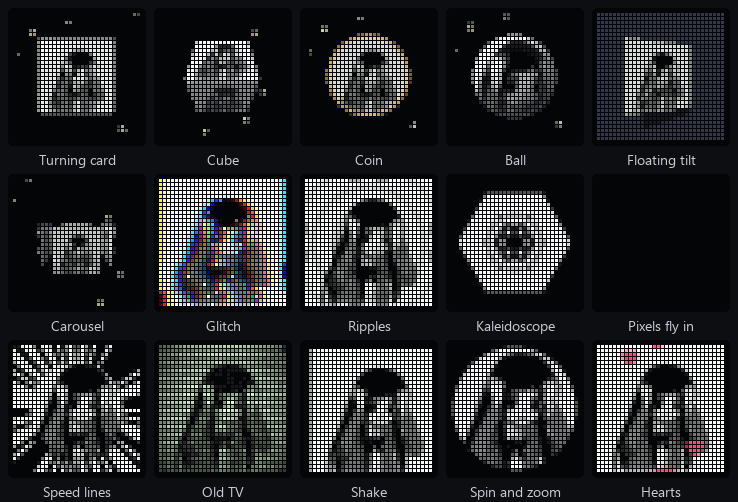

# Your picture

One animated GIF, [`girl_panic.gif`](girl_panic.gif) (16 frames), through all 15 effects of the web app's
**Create → Animation → Generate → Your picture**, as the panel shows them: 32 × 32, 3 seconds at 15 frames a
second. The GIF keeps playing inside every effect.

- **3D** (drawn by the web app's 3D scene maker): turning card, cube, coin, ball, floating tilt, carousel.
- **2D:** glitch, ripples, kaleidoscope, pixels fly in, speed lines, old TV, shake, spin and zoom, hearts.

[`panel/`](panel) has each one as a 32 × 32 GIF with the panel's exact colours. To put one on your panel,
open **Create → Animation → From files** and pick it. To make your own, choose **Generate**, set the kind to
**Your picture**, and pick any picture or GIF.

`girl_panic.gif` and the animations made from it are examples only; the project's GPL licence doesn't cover
them.
